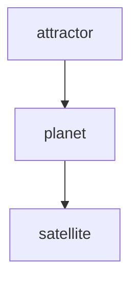

# Orbital Hierarchy Canon

This document formalizes the canonical orbital interpretation used across NOEMA.

## Core rule

Every higher-order structure is loaded as an orbital shell:

- depth 0: `attractor`
- depth 1: `planet`
- depth 2: `satellite`
- depth 3+: `sub-satellite`

The same rule applies to:

- oscillatory layers,
- memory layers,
- recursive subsystem expansion,
- Mermaid/visual renderings.

## Meaning of the layers

- `attractor` is the root state that anchors the hierarchy.
- `planet` is the first dependent orbit around the attractor.
- `satellite` is a second-order orbit.
- `sub-satellite` is recursive orbiting of orbiting nodes.

This matches the user-facing idea that a star has planets, planets have satellites, and satellites may have their own satellites.

## Canonical implementation

The hierarchy helper lives in [`src/ciel_geometry/orbital_hierarchy.py`](/home/adrian/new_volume_rw/CIEL_PROJECT_CANON/NOEMA/src/ciel_geometry/orbital_hierarchy.py).

It formalizes the existing `OrbitalTree` structure and provides:

- `OrbitalHierarchy`
- `OrbitalHierarchyNode`
- `orbit_load_order()`
- `render_orbital_mermaid()`
- `layer_name_for_depth()`
- `choose_root_id()`

The helper reads `system_map_v2.json`, selects a root, walks dependency edges, and emits:

- JSON-friendly hierarchy data,
- orbital load order for memory-like bootstrapping,
- Mermaid flowchart output for architecture diagrams.

## Load order

The intended order is:

1. root attractor,
2. first orbital shell,
3. second orbital shell,
4. recursive shells until the requested depth limit.

This means memory layers should not be loaded as a flat bucket. They should be initialized orbit-by-orbit, so that each layer can depend on the one beneath it.

## Mermaid example

## Practical use

Use this canon when:

- generating orbit-aware load orders,
- rendering subsystem maps,
- reasoning about recursive memory tiers,
- formalizing "orbital" bootstrapping in CIELingo and NOEMA.

When the structure changes, update the map first, then regenerate the hierarchy view.
